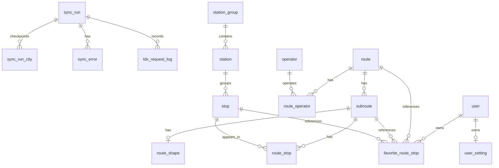

# Development Plan

[English](./plan.md) | [繁體中文](./plan.zh-TW.md)

## Overview

Only the frontend is deployed to production, on GitHub Pages, and it calls the TDX API through the Cloudflare Worker proxy for both base data and realtime data. This fit the early work, which focused on exploring the frontend framework. But the approach has unavoidable drawbacks: every visitor spends the shared TDX key's quota, and the frontend has to compose raw TDX data itself.

A NestJS backend with a PostgreSQL database can now run locally. It syncs TDX base data into the database, serves route and station data from it, and serves cached TDX realtime snapshots. The web app reads both base and realtime data from it in local API mode. The remaining work is to deploy the API and switch production to it.

## Goals

- Reduce direct TDX usage by moving common route and stop flows to app-owned data. The backend should not be only a proxy: it stores non-realtime base data, and the frontend depends on it for common route and stop flows.
- Run on the free TDX membership in the long term. See [TDX Quota](#tdx-quota) for what fits it today.

## Architecture

### Monorepo

```txt
apps/
  web/        React Router frontend
  tdx-proxy/  Cloudflare Worker proxy for TDX authentication
  api/        NestJS backend
packages/
  shared/     shared API contracts, enums, and TDX upstream types
```

The shared package stays small and only contains contracts that are truly shared between frontend and backend. Nest-specific DTO classes stay in the API workspace.

### Backend

The NestJS API is responsible for:

- TDX authentication
- scheduled or manual base-data sync
- route and station endpoints backed by the database
- realtime snapshots fetched from TDX and cached briefly in memory
- request shaping and response DTOs
- TDX quota protection

API documentation uses Scalar with OpenAPI, and grows together with the endpoints.

### Database

The API uses PostgreSQL with Prisma. The Prisma schema in `apps/api/prisma/models/` is the source of truth for tables, columns, and indexes, and `apps/api/AGENTS.md` holds the naming and type rules. This section records the decisions behind the schema.

The schema covers base data (routes, sub-routes, operators, station groups, stations, stops, route stops, and route shapes) and sync bookkeeping. Models for vehicles, users, favorites, and settings exist, but nothing uses them yet.



Decisions:

- **Stations, not stop signs, for nearby flows.** TDX separates station groups, stations, and stops, so the schema keeps three tables. A stop is one physical sign and is what `route_stop` points to. `station.station_group_id` and `stop.station_id` are nullable because station data is incomplete in some cities. The nearby endpoint returns page-ready stations, so the frontend does not need to know which TDX resources built them.
- **Identifiers.** Public `uuid` values come from TDX: a route's is its `RouteUID`, a stop's is its `StopUID`, a station's is its `StationUID`, and a sub-route's is `<SubRouteUID>-<Direction>`, since one TDX sub-route can run in both directions. Raw TDX IDs that other data refers to are kept in `tdx_*` columns, such as `tdx_subroute_uid` and `tdx_stop_id`.
- **Route stops are ordered by `sequence`.** A sub-route can visit the same stop more than once, so `route_stop` is unique by sub-route and sequence, not by stop.
- **No `area` column.** The API maps a search area to its cities when querying.
- **Route shapes are stored as readable paths.** `route_shape.path` holds `[longitude, latitude]` pairs, and `source` records whether it came from an encoded polyline, a geometry, or stop positions. When TDX has no usable shape, the path is built from ordered stop positions.
- **No PostGIS for now.** Nearby search uses plain latitude and longitude columns with bounding boxes and precise distance. PostGIS can wait until spatial queries need it.
- **English addresses are translated, not synced.** TDX only provides Chinese addresses. Sync keeps `address_en` while `address_zh_tw` is unchanged, and clears it when the Chinese address changes.
- **Realtime data is not stored.** The API caches realtime snapshots in memory; see [Realtime](#realtime).
- **Base data is soft-deleted.** Favorites may reference routes and stops, so records missing from the latest TDX response are marked inactive instead of deleted, and are reactivated if they come back. Favorite rows themselves can be deleted.

### Base-Data Sync

- An admin endpoint creates a `sync_run` and returns at once. A background service runs the sync, so the HTTP request does not stay open while all cities sync.
- Route and stop syncs process the supported cities one at a time and record a `sync_run_city` checkpoint for each. A retried run skips completed cities. Sync writes are idempotent, so a city that was interrupted can run again.
- Sync services describe what to fetch; the sync TDX client owns pacing and quota. It writes one `tdx_request_log` row per request and checks the minute and month quota against those rows before each request, using a PostgreSQL advisory lock so API instances share one count.
- When the quota is exhausted for now, the run becomes `pending` with a `resume_after_at` time. Unexpected errors mark the run `failed`.
- Mappers are split by boundary: TDX to database records close to Prisma fields, and database records to API responses close to page-ready contracts.
- `records_*` counters use the sync resource as their unit; a route run counts route rows, not sub-route or operator writes.
- A monthly cadence is enough, because base route and stop data change rarely.

See `apps/api/docs/sync-troubleshooting.md` for failures seen so far.

### Realtime

`GET /api/realtime/routes/:uuid` fetches one route's ETA, near-stop, and GPS feeds from TDX when asked, and returns what each sub-route should show. Each route's snapshot is cached in memory for 90 seconds, or 5 seconds after a failed feed, and concurrent requests share one fetch. A separate realtime TDX client limits itself to 3 requests per second by default, leaving headroom on the shared key for sync and the proxy.

The rules that turn the three feeds into arrivals, vehicles, and statuses live in `calculateRouteRealtime` in `packages/shared`. The web app runs the same code while it still calls TDX directly, so both sources show the same results. Some rules cover upstream data that does not map cleanly to a sub-route:

- **ETAs with an unknown direction.** TDX can tag ETAs with direction `255`. They still apply to the sub-route they name. Tainan uses them for buses that have not left yet, and ignoring them left many stops without a countdown.
- **Sub-routes without their own ETAs.** Such a sub-route only uses ETAs that TDX sends without any sub-route, as Taipei does, matched by stop. It never uses ETAs tagged with another sub-route, which made Tainan's 白河→柳營奇美醫院 short trip show buses of the full-length route.
- **Vehicles at a last-bus-passed stop.** A vehicle at a stop whose ETA says the last bus has passed shows as in service, since the vehicle is clearly running.
- **Stops visited twice.** About 5% of active sub-routes visit a stop twice. Each visit gets its own ETA, matched by stop sequence.

These rules were checked against citywide TDX ETAs from all 22 supported cities on 2026-10-21. Only Tainan tags ETAs with direction `255` or has sub-routes that relied on another sub-route's ETAs. Taipei and New Taipei send ETAs without a sub-route. Every other city tags each ETA with a sub-route that exists on its route. Check again when TDX adds a city or changes how a city tags its ETAs.

### Deployment

Keep the frontend on GitHub Pages.

Deploy the NestJS backend to a long-running host such as Render with a managed PostgreSQL database. Local development uses Prisma Postgres; choose and document the production database provider before deployment.

Do not deploy the sync worker to a serverless platform: it resumes background sync runs and may run for a long time. Run a single API instance, since the realtime cache and rate limiter live in memory.

Before deployment:

- confirm the PostgreSQL and hosting projects, and how the API connects to the database
- set environment variables in the host, keeping only placeholders in `.env.example`
- decide how committed Prisma migrations run against the production database
- protect the admin sync endpoints before they can change data
- decide where the scheduled monthly sync runs

Once the API is deployed and the web app reads all data from it, retire the TDX proxy. Until then, production needs the proxy, and it shares the TDX key with the API.

## Current State

### API Endpoints

Application endpoints are prefixed with `/api`.

| Method | Endpoint                     | Description                                       |
| ------ | ---------------------------- | ------------------------------------------------- |
| GET    | `/api/health`                | Health check                                      |
| GET    | `/api/routes?area=...`       | Route list for one search area, from the database |
| GET    | `/api/routes/:uuid`          | Route detail with sub-routes, stops, and shapes   |
| GET    | `/api/stations`              | Nearby stations with their routes                 |
| GET    | `/api/realtime/routes/:uuid` | Realtime snapshot for one route, from TDX         |
| POST   | `/api/admin/sync/routes`     | Queue a route sync from TDX                       |
| POST   | `/api/admin/sync/stops`      | Queue a stop sync from TDX                        |
| GET    | `/api/admin/sync/runs`       | List recent sync runs                             |
| GET    | `/api/admin/sync/runs/:uuid` | Get one sync run with city progress               |

Notes:

- Route detail includes TDX references (each sub-route's `SubRouteUID`, and each stop's `StopID` and `StationID`) so saved favorite IDs stay stable, and so the web app can match TDX realtime data while it still calls TDX directly.
- Nearby stations always correspond to a station record. Stops without a station are left out until their product behavior is decided. Station addresses merge the station's and its stops' addresses per language.
- In local API mode, the Nearby page stores station UUIDs in its URL. Selection URLs from TDX mode are not translated.
- Favorite and settings endpoints exist only as contract placeholders; see [Backlog](#backlog).

### Progress

- The monorepo, NestJS API, Scalar documentation, Prisma schema, and migrations are in place.
- Route and stop sync run in the background across all supported cities, record TDX requests, protect the quota, resume by city checkpoint, and soft-deactivate records missing upstream. Full syncs have been validated across Taiwan, most recently in October 2026.
- Sync runs can be inspected through the admin sync run endpoints.
- In local API mode, the Nearby, Routes, and Route pages read base data from the database API, and the Route page reads realtime data from the realtime API; default and production web builds still use the TDX proxy.
- The web app chooses the data source in one place, `transitApi`, so pages and hooks consume the same app-facing models in either mode.
- Realtime results follow the same rules in both modes, since the API and the web app share the code that computes them.

### Storage

Observed on 2026-10-13, after the October route and stop syncs. Sizes come from `pg_size_pretty`, which uses binary units.

- total database size: about 191 MiB, up from about 148 MB on 2026-07-10
- Prisma Free storage limit reference: 512 MiB

| Table            | Estimated rows | Total size | Table data | Indexes | Notes                                                               |
| ---------------- | -------------: | ---------: | ---------: | ------: | ------------------------------------------------------------------- |
| `route_stop`     |        244,063 |     83 MiB |     33 MiB |  49 MiB | Largest table; indexes are larger than row data.                    |
| `stop`           |        136,965 |     60 MiB |     34 MiB |  26 MiB | Main stop sync table.                                               |
| `station`        |         52,163 |     18 MiB |    9.9 MiB | 8.4 MiB | Station data is not available for every city.                       |
| `route_shape`    |          6,141 |     11 MiB |     11 MiB | 656 KiB | Shared by route detail rendering and stop-position fallback shapes. |
| `subroute`       |          7,049 |    4.7 MiB |    2.9 MiB | 1.7 MiB | Route direction and variant rows.                                   |
| `station_group`  |          6,684 |    2.7 MiB |    1.6 MiB | 1.1 MiB | Optional because TDX support differs by city.                       |
| `route`          |          3,139 |    1.2 MiB |    768 KiB | 440 KiB | Route list data.                                                    |
| `route_operator` |          3,115 |    528 KiB |    208 KiB | 288 KiB | Route/operator join rows.                                           |

Stop-related tables take about 164 MiB, route-related tables about 6.5 MiB, route shapes about 11 MiB, and sync bookkeeping less than 1 MiB. Tables for later features are empty but still hold a little metadata.

Since July, row counts grew about 4% while the database grew about 30%. Inactive rows are few (for example, 334 of about 244,000 route stops), so most of the growth is likely space left by sync rewriting rows, which autovacuum marks reusable but does not return. Check whether the size keeps growing after future syncs.

## Next Steps

1. Deploy the API as its own change, following the checklist in [Deployment](#deployment).
2. After the public API is deployed, switch production web builds to the database API and validate that route search, route detail, shapes, realtime, and locale fallback match the TDX-backed experience. Watch for sub-route tab order: the API orders sub-routes by direction, while TDX keeps upstream order.

### TDX Quota

The project aims to run on the free TDX basic membership (5 requests per minute per key, 3 points per month: 1,500 requests or 150MB per point) and currently uses the bronze membership (5 requests per second, 200 points per month).

- Base-data sync fits the free tier. One route and stop sync used about 100 requests and 175MB of decompressed responses in October 2026.
- Realtime data does not fit the free tier through TDX. Each refresh needs three requests (ETA, near-stop, and GPS), and TDX offers no endpoint that combines them, so 5 requests per minute serves about two routes at a time across all users.
- Production web builds still call TDX for base data through the proxy, so the free tier also requires the production switch to the database API.
- City open-data feeds are the candidate path to free realtime data. Taipei publishes a citywide ETA file without an API key, updated about every 20 seconds. Before building on such feeds, check each city's update rate, identifiers, license, and access limits, and whether they report whether a vehicle is arriving at or leaving a stop.

### Product Name

The product is called 找找公車 in Traditional Chinese and keeps Finding the Bus in English. The English name was a pun on Finding Nemo, which not every user will catch; the Chinese name says plainly what the app is for while keeping a light tone. The domain stays `bus.lynns.me`.

Only the Chinese user-facing name changes: the `app.name` value in the zh-TW locale, which sets the page title and the site heading, and the title of `docs/README.zh-TW.md`. English names stay as they are, including `FTBError`, the `FTB API` titles, the Worker name, the `@bus/*` packages, and the repository.

### Visual Identity

Before this work, the app had little visual identity. A first pass of all five steps below is done; later changes refine it:

- No part of the interface showed the product name. The desktop header held only the navigation links and the settings button, and mobile had no header at all.
- No page had an `h1`. Page titles such as 搜尋公車 were `h3`.
- The theme used Mantine's default cyan as the only brand color.
- The theme set Open Sans, but the page loaded Inter, so neither font was used, and Chinese text fell back to the system font.
- The only brand mark was the favicon: a white bus on a cyan circle.

The work is split into steps so each one can be reviewed on its own:

1. **Site heading.** Show the product name as the page's `h1`, with the favicon mark beside it, and lower page titles to `h2`. On desktop, the heading sits at the left of the header, before the navigation links. On mobile, a new top banner holds the heading and the settings button, which replaces the floating settings button. Layout heights that depend on the header, such as the drawer offset, must follow the new banner height.
2. **Name.** Change the zh-TW `app.name` to 找找公車 and update the Chinese README title.
3. **Color and type.** Choose a brand color palette for Mantine and the map, and fix the font setup so the theme and the loaded fonts agree, including a font for Chinese.
4. **Brand mark.** Redraw the favicon as a logo that also works next to the site heading, and use it for the PNG favicon and app icons.
5. **Surfaces.** Apply the palette to the header, the mobile banner, the bottom navigation, cards, empty states, and map markers, and check that contrast stays readable.

Decisions for steps 3 to 5:

- **Font.** Use Chiron GoRound TC, a rounded Traditional Chinese font from Google Fonts with regular and bold weights. Google Fonts splits it by character range, so a page only downloads the characters it shows. jf open huninn was tried first, but it has a single weight and headings need a real bold.
- **How colors are chosen.** Colors are assigned by the job they do, and every color that must be told apart is checked with a palette validator for lightness, chroma, separation under color blindness, normal-vision separation, and contrast:
  - Map identities, which can sit next to each other anywhere on the map, are limited to three hues that pass the all-pairs check: blue `#2a78d6` for the route and its stops, orange `#eb6834` for vehicles, and green `#1baf7a` for the highlighted stop. Each marker also has a white ring and a number or icon, so color is never the only cue.
  - Status colors are reserved for messages: red `#d03b3b` for errors and yellow `#fab219` for warnings, always with a title and text.
  - Each color is a Mantine palette of ten steps built in OKLCH around the chosen value, overriding Mantine's built-in color of the same name, so component code keeps using `blue`, `orange`, `teal`, `red`, `yellow`, `pink`, and `gray`. Step 6, used for text in light variants, keeps at least 4.5:1 contrast on white.

  | Role                                 | Color                                      |
  | ------------------------------------ | ------------------------------------------ |
  | Site heading, primary actions, route | blue                                       |
  | Mobile banner                        | blue, with white text                      |
  | Vehicles and realtime cues           | orange                                     |
  | Highlighted stop                     | green (`teal`)                             |
  | Favorites                            | pink                                       |
  | Errors and warnings                  | red and yellow                             |
  | Page background, city badges         | light cool gray, with white cards and bars |

### UI and UX Follow-ups

A design review of the visual refresh, at desktop (1440px) and mobile (375px) widths, led to a follow-up pass:

- Favorite and settings buttons use 44px touch targets.
- Every page puts white cards with a small shadow straight on the gray page, with no extra white column or card borders.
- The mobile bottom navigation shows each icon above its label, and the brand mark has a white ring on the blue mobile banner.
- The mobile route map shows a label with the route name and direction, which opens the stop list.
- The map drawer buttons use a list icon, and the no-service status is one line of text instead of an alert.

One issue is still open: on the mobile route map, stop markers overlap at the initial zoom. A fix could show only the route line and its terminal stops until the user zooms in, which needs changes to the map layers.

## Backlog

These wait until the backend is deployed and stable:

- **Account and auth.** Favorites and settings stay frontend-local until login exists, because backend-owned favorites and settings are mainly useful for syncing across devices. The favorites and settings APIs follow auth.
- **Stop-level lookup endpoint**, if route pages need it.
- **Admin manager.** A separate `apps/manager` workspace for sync operations: list runs and their status, show city checkpoints, TDX request usage, and sync errors, and trigger or retry a run. Keep it read-only apart from explicit sync actions, and protect every route before exposing it. Until then, use Prisma Studio and logs.
- **A shared realtime cache**, such as Redis, if the API ever needs more than one instance.
- **SSE or WebSocket delivery** for realtime data.
