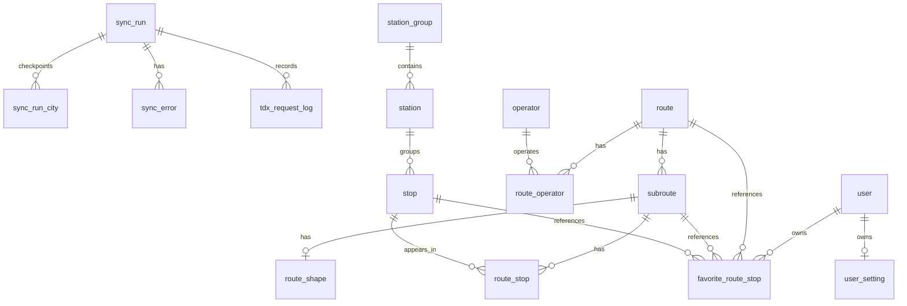

# 開發計畫

[English](./plan.md) | [繁體中文](./plan.zh-TW.md)

## 概況

目前僅有前端正式部署在 GitHub Pages，基礎資料和即時資料都是透過 Cloudflare Worker proxy 直接打 TDX API。這是因應初期探索前端框架的需要。但這種做法有無可避免的缺點：每個使用者都在消耗同一把 TDX key 的額度，前端也得自己組合 TDX 的原始資料。

現在已經有一個可以在本機執行的 NestJS 後端，搭配 PostgreSQL 資料庫。後端會把 TDX 的基礎資料 sync 進資料庫，用資料庫提供路線和站位資料，也會提供有 cache 的 TDX 即時資料快照。前端在本地開發時，基礎資料和即時資料都可以改讀 API。接下來要做的是部署 API，然後把正式環境切過去。

## 目標

- 減少直接打 TDX 的次數，把常用的路線和站牌流程改成讀自己的資料。後端不只是一層 proxy：後端要存好非即時的基礎資料，讓前端在常用的路線和站牌流程上改用這些資料。
- 長期希望只用 TDX 的免費方案。目前哪些部分做得到，請看 [TDX 額度](#tdx-額度)。

## 架構

### Monorepo

```txt
apps/
  web/        React Router 前端
  tdx-proxy/  處理 TDX 驗證的 Cloudflare Worker proxy
  api/        NestJS 後端
packages/
  shared/     共用的 API contract、enum 和 TDX 上游型別
```

shared 要維持精簡，只放前後端真的會共用的 contract。NestJS 專用的 DTO class 留在 API workspace。

### 後端

NestJS API 負責：

- TDX 驗證
- 排程或手動的基礎資料 sync
- 由資料庫提供的路線和站位 endpoint
- 向 TDX 取得、並在記憶體裡短暫 cache 的即時資料快照
- 整理 request 和 response DTO
- 保護 TDX 額度

API 文件用 Scalar 搭配 OpenAPI，隨著 endpoint 一起擴充。

### 資料庫

API 用 PostgreSQL 搭配 Prisma。資料表、欄位和 index 以 `apps/api/prisma/models/` 裡的 Prisma schema 為準，命名和型別規則寫在 `apps/api/AGENTS.md`。這一節記錄的是 schema 背後的決策。

schema 涵蓋基礎資料（路線、子路線、業者、站位群組、站位、站牌、路線站序、路線形狀）和 sync 的紀錄。車輛、使用者、收藏、設定的 model 也已經建好，只是還沒有功能用到。



決策：

- **附近站牌以站位為單位，不是以站牌為單位。** TDX 把站位群組、站位、站牌分開，所以 schema 也分成三張表。站牌指的是一支實體站牌，也是 `route_stop` 所指向的資料。有些城市的站位資料不完整，所以 `station.station_group_id` 和 `stop.station_id` 可以是 null。附近站牌的 endpoint 直接回傳整理好的站位，前端不用知道是用 TDX 的哪些資料組出來的。
- **ID。** 對外的 `uuid` 都來自 TDX：路線是 `RouteUID`、站牌是 `StopUID`、站位是 `StationUID`，子路線則是 `<SubRouteUID>-<Direction>`，因為同一個 TDX 子路線可能有兩個方向。其他資料會用到的 TDX 原始 ID，存在 `tdx_*` 欄位，例如 `tdx_subroute_uid` 和 `tdx_stop_id`。
- **路線站序用 `sequence` 排。** 一個子路線可能經過同一個站好幾次，所以 `route_stop` 是以「子路線 + 站序」為唯一，不是以站牌為唯一。
- **不存 `area` 欄位。** 查詢時由 API 把搜尋區域換成對應的城市。
- **路線形狀存成看得懂的座標。** `route_shape.path` 存 `[經度, 緯度]` 的陣列，`source` 記錄路徑來自 encoded polyline、geometry，還是站牌座標。TDX 沒有可用的形狀時，就用依站序排好的站牌座標組出來。
- **暫時不用 PostGIS。** 附近站牌的搜尋用一般的經緯度欄位，先用範圍框篩選，再算精確距離。等真的需要空間查詢時再考慮 PostGIS。
- **英文地址是翻譯來的，不是 sync 來的。** TDX 只提供中文地址。sync 時只要 `address_zh_tw` 沒變，就保留 `address_en`；中文地址變了，就清掉 `address_en`。
- **即時資料不存進資料庫。** API 把即時資料快照 cache 在記憶體，請看 [即時資料](#即時資料)。
- **基礎資料用軟刪除。** 收藏可能會指向路線和站牌，所以最新 TDX 資料裡消失的紀錄只標成停用，不直接刪掉；之後又出現的話就重新啟用。收藏本身的資料列可以直接刪。

### 基礎資料 Sync

- admin endpoint 建立一筆 `sync_run` 後馬上回應，實際的 sync 在背景執行，這樣 HTTP request 不用在所有城市 sync 完之前一直開著。
- 路線和站牌的 sync 會一個城市一個城市處理，每個城市記一筆 `sync_run_city` checkpoint。重新執行時會跳過已經完成的城市。sync 寫入是冪等的，所以中斷的城市可以安全地重新執行。
- sync service 只描述要抓什麼，速度和額度由 sync 用的 TDX client 控管。這個 client 每打一次 TDX 就寫一筆 `tdx_request_log`，每次發出 request 前，都會根據這些紀錄檢查這分鐘和這個月的額度，並用 PostgreSQL 的 advisory lock 讓不同的 API instance 共用同一份計數。
- 額度暫時用完時，sync run 會變成 `pending`，並記下可以重試的時間 `resume_after_at`。遇到預期外的錯誤就標成 `failed`。
- mapper 依邊界分開：TDX 轉資料庫紀錄的，貼近 Prisma 欄位；資料庫紀錄轉 API response 的，貼近頁面要用的 contract。
- `records_*` 計數以 sync 的資源為單位：路線 sync 算的是路線的資料列，不含子路線和業者的寫入。
- 一個月 sync 一次就夠了，因為路線和站牌的基礎資料很少變動。

目前遇過的 sync 失敗和處理方式，請看 `apps/api/docs/sync-troubleshooting.md`。

### 即時資料

`GET /api/realtime/routes/:uuid` 被呼叫時，才去 TDX 抓那條路線的到站時間、靠站資訊和 GPS 位置，並回傳每個子路線要顯示的內容。每條路線的快照會在記憶體 cache 90 秒，有來源失敗時只 cache 5 秒；同一條路線同時有多個 request 時，只會抓一次。即時資料有自己的 TDX client，預設每秒最多 3 次，把同一把 key 剩下的額度留給 sync 和 proxy。

把三種資料算成到站時間、車輛和狀態的規則，寫在 `packages/shared` 的 `calculateRouteRealtime`。前端在還直接呼叫 TDX 的期間也執行同一份程式，所以兩種來源顯示的結果一樣。有幾條規則是在處理上游資料對不上子路線的情況：

- **方向未知的到站資料。** TDX 會把某些到站資料的方向標成 `255`。這些資料還是屬於它標示的子路線。台南用這種資料表示還沒發車的班次，忽略的話會有很多站看不到倒數時間。
- **沒有自己到站資料的子路線。** 這種子路線只會用 TDX 沒有標示子路線的到站資料（台北就是這樣），並依站牌對應。標示為其他子路線的到站資料一律不用，否則台南「白河→柳營奇美醫院」區間車會顯示全程車的到站時間。
- **停在「末班已過」站的車。** 如果車輛所在那一站的到站資料是「末班已過」，車輛會顯示「行駛中」，因為這台車明顯還在跑。
- **經過同一站兩次的子路線。** 全台約 5% 的子路線會經過同一站兩次，每一次都依站序對應到各自的到站時間。

這些規則在 2026-10-21 用 22 個支援縣市的全市到站資料確認過：只有台南會把到站資料的方向標成 `255`，也只有台南有子路線原本要借用其他子路線的到站資料。台北和新北的到站資料沒有標示子路線，其他縣市則都標示了路線上實際存在的子路線。TDX 新增縣市，或某個縣市改變標示方式時，要再確認一次。

### 部署

前端繼續放在 GitHub Pages。

NestJS 後端要部署到常駐的主機，例如 Render，再搭配託管的 PostgreSQL。本機開發用的是 Prisma Postgres，正式環境的資料庫要在部署前選好，並寫進文件。

sync worker 不要部署到 serverless 平台：sync worker 會接續背景的 sync run，可能執行很久。另外 API 只能執行一個 instance，因為即時資料的 cache 和限流都在記憶體裡。

部署前要先處理：

- 確認 PostgreSQL 和主機的專案，以及 API 怎麼連到資料庫
- 在主機上設定環境變數，`.env.example` 只放範例值
- 決定已 commit 的 Prisma migration 要怎麼套用到正式資料庫
- 先替 admin sync endpoint 加上保護，才能讓這些 endpoint 改動資料
- 決定每月的排程 sync 要在哪裡執行

等 API 部署好、前端的資料都改由 API 提供之後，就停用 TDX proxy。在那之前，正式環境還是需要 proxy，而且 proxy 跟 API 共用同一把 TDX key。

## 目前狀態

### API Endpoint

應用的 endpoint 都以 `/api` 開頭。

| Method | Endpoint                     | 說明                                   |
| ------ | ---------------------------- | -------------------------------------- |
| GET    | `/api/health`                | 健康檢查                               |
| GET    | `/api/routes?area=...`       | 某個搜尋區域的路線列表，來自資料庫     |
| GET    | `/api/routes/:uuid`          | 路線詳情，包含子路線、站牌和路線形狀   |
| GET    | `/api/stations`              | 附近的站位和經過的路線                 |
| GET    | `/api/realtime/routes/:uuid` | 單一路線的即時資料快照，來自 TDX       |
| POST   | `/api/admin/sync/routes`     | 排入一次路線 sync                      |
| POST   | `/api/admin/sync/stops`      | 排入一次站牌 sync                      |
| GET    | `/api/admin/sync/runs`       | 最近的 sync run 列表                   |
| GET    | `/api/admin/sync/runs/:uuid` | 單一 sync run 的詳情，包含各城市的進度 |

補充：

- 路線詳情會附上 TDX 的對應 ID（每個子路線的 `SubRouteUID`，以及每個站牌的 `StopID` 和 `StationID`），讓已存的收藏 ID 維持不變，也讓前端在還直接呼叫 TDX 的期間，能對上 TDX 的即時資料。
- 附近站牌回傳的每一筆都對應到一個站位。沒有站位的站牌目前不回傳，等決定好產品上的呈現方式再處理。站位地址會把站位本身和底下站牌的地址，依語言合併。
- 在 local API 模式（`pnpm run dev:api`，本地開發時改用 API 的模式）下，附近站牌頁的網址存的是站位 uuid。TDX 模式下的網址不會自動轉換。
- 收藏和設定的 endpoint 目前只是 contract placeholder，請看 [待辦](#待辦)。

### 進度

- monorepo、NestJS API、Scalar 文件、Prisma schema 和 migration 都已經建好。
- 路線和站牌的 sync 會在背景處理所有支援的城市：記錄 TDX request、保護額度、依城市 checkpoint 接續，並把上游已經沒有的資料標成停用。完整的 sync 已經在全台執行過，最近一次是 2026 年 10 月。
- 可以透過 admin 的 sync run endpoint 查看 sync 的狀況。
- local API 模式下，附近站牌、搜尋公車和路線頁的基礎資料都改讀資料庫 API，路線頁的即時資料也改讀即時資料 API；預設模式和正式環境還是走 TDX proxy。
- 前端只在 `transitApi` 一個地方決定資料來源，所以兩種模式下，頁面和 hook 拿到的都是同一種前端 model。
- API 和前端共用計算即時資料的程式，所以兩種模式下的即時資料規則都一樣。

### 資料庫大小

2026-10-13 的觀察，在 10 月的路線和站牌 sync 之後。大小來自 `pg_size_pretty`，單位是以 1024 計算的 MiB、KiB。

- 資料庫總大小：約 191 MiB，2026-07-10 時約 148 MB
- Prisma 免費方案的容量上限參考：512 MiB

| 資料表           | 估計列數 |  總大小 | 資料本身 |   Index | 說明                                      |
| ---------------- | -------: | ------: | -------: | ------: | ----------------------------------------- |
| `route_stop`     |  244,063 |  83 MiB |   33 MiB |  49 MiB | 最大的表，index 比資料本身還大。          |
| `stop`           |  136,965 |  60 MiB |   34 MiB |  26 MiB | 站牌 sync 的主要資料表。                  |
| `station`        |   52,163 |  18 MiB |  9.9 MiB | 8.4 MiB | 不是每個城市都有站位資料。                |
| `route_shape`    |    6,141 |  11 MiB |   11 MiB | 656 KiB | 路線詳情和站牌座標備援共用的形狀資料。    |
| `subroute`       |    7,049 | 4.7 MiB |  2.9 MiB | 1.7 MiB | 路線的方向和支線。                        |
| `station_group`  |    6,684 | 2.7 MiB |  1.6 MiB | 1.1 MiB | 不一定有，因為 TDX 的支援程度依城市而異。 |
| `route`          |    3,139 | 1.2 MiB |  768 KiB | 440 KiB | 路線列表資料。                            |
| `route_operator` |    3,115 | 528 KiB |  208 KiB | 288 KiB | 路線和業者的關聯。                        |

站牌相關的表約 164 MiB，路線相關的表約 6.5 MiB，路線形狀約 11 MiB，sync 紀錄不到 1 MiB。之後功能要用的表目前是空的，但還是會佔一點 metadata 的空間。

跟 7 月比，資料列只多了約 4%，資料庫卻大了約 30%。停用的資料列很少（例如 24 萬多筆路線站序裡只有 334 筆），所以多出來的空間比較可能是 sync 改寫資料列後留下的：autovacuum 會把這些空間標成可重用，但不會還回去。之後每次 sync 完，要再確認大小有沒有持續增加。

## 下一步

1. 部署 API，獨立成一個改動，照 [部署](#部署) 的清單進行。
2. API 公開部署後，把正式環境的前端切到資料庫 API，並確認路線搜尋、路線詳情、路線形狀、即時資料和語言備援都跟 TDX 版本一樣。要特別注意子路線分頁的順序：API 依方向排序，TDX 則照上游的順序。

### TDX 額度

這個專案的長期目標是用 TDX 的免費方案（基礎會員：每把 key 每分鐘 5 次，每月 3 點，每點可以打 1,500 次或 150MB），目前用的是銅級會員（每秒 5 次，每月 200 點）。

- 基礎資料的 sync 用免費方案就夠了。2026 年 10 月執行一次路線和站牌 sync，大約打了 100 次，解壓後的回應約 175MB。
- 如果只靠 TDX，即時資料無法用免費方案支撐。每次更新要打 3 支（到站時間、靠站資訊、GPS 位置），TDX 也沒有一次拿到三種資料的 API，所以每分鐘 5 次，全部使用者加起來大概只能同時查看兩條路線。
- 正式環境的前端還在透過 proxy 向 TDX 拿基礎資料，所以要用免費方案，也得先把正式環境切到資料庫 API。
- 要讓即時資料免費，比較可行的方向是改接各縣市自己的開放資料。台北市有一份不需要 API key 的全市到站時間檔案，大約每 20 秒更新一次。要用這類資料之前，要先確認每個縣市的更新頻率、ID 怎麼對應、授權和存取限制，以及有沒有提供車輛是進站還是離站。

### 產品名稱

產品的中文名稱是「找找公車」，英文維持 Finding the Bus。英文名稱是《海底總動員》（Finding Nemo）的諧音梗，不是每個使用者都會懂；中文名稱則直接說出這個 app 的用途，也保留輕鬆的語氣。網域維持 `bus.lynns.me`。

這次只改中文的使用者可見名稱：zh-TW 語系檔裡的 `app.name`（會用在網頁標題和網站標題），以及 `docs/README.zh-TW.md` 的標題。英文名稱都不變，包括 `FTBError`、`FTB API` 標題、Worker 名稱、`@bus/*` 套件和 repo 名稱。

### 主視覺

在這項工作之前，網站幾乎沒有自己的視覺識別。下面五個步驟的第一輪都已經完成，之後再逐步調整：

- 介面上沒有任何地方顯示產品名稱。電腦版的頂部只有導覽連結和設定按鈕，手機版則完全沒有頂部列。
- 沒有任何頁面有 `h1`。「搜尋公車」這類頁面標題是 `h3`。
- 主題只用 Mantine 預設的 cyan 當品牌色。
- 主題設定的字型是 Open Sans，但頁面載入的是 Inter，所以兩個都沒有真的用到，中文則是用系統字型。
- 唯一的品牌圖案是 favicon：cyan 圓形裡的白色公車。

這項工作分成幾個步驟，讓每一步都能單獨 review：

1. **網站標題。** 用產品名稱當頁面的 `h1`，旁邊放 favicon 的圖案，頁面標題改成 `h2`。電腦版放在頂部列左邊、導覽連結前面。手機版新增一條頂部橫幅，放網站標題和設定按鈕，取代目前浮在畫面上的設定按鈕。跟頂部列高度有關的版面設定（例如 drawer 的位置）也要跟著新的橫幅高度調整。
2. **名稱。** 把 zh-TW 的 `app.name` 改成「找找公車」，並更新中文 README 的標題。
3. **顏色和字型。** 決定 Mantine 和地圖用的品牌色，並修正字型設定，讓主題設定和實際載入的字型一致，也要有中文字型。
4. **品牌圖案。** 重新設計 favicon，做成也能放在網站標題旁邊的 logo，並用在 PNG favicon 和 app icon。
5. **套用到介面。** 把品牌色套用到頂部列、手機版橫幅、底部導覽、卡片、空狀態和地圖標記，並確認對比度足夠、文字清楚。

第 3 到 5 步的決定：

- **字型。** 使用 Chiron GoRound TC，這是 Google Fonts 上的繁體中文圓體，有一般和粗體兩種字重。Google Fonts 會依字元範圍把字型切成小檔，頁面只會下載實際用到的字。一開始試過 jf 粉圓，但它只有一種字重，標題需要真正的粗體。
- **配色的方法。** 顏色依用途分配，每一組需要區分的顏色，都用配色檢查工具確認明度、彩度、色盲時的區分度、一般視覺的區分度和對比度：
  - 地圖上的識別色可能在任何位置相鄰，所以限制在通過全配對檢查的三種色相：藍色 `#2a78d6` 是路線和站牌，橘色 `#eb6834` 是車輛，綠色 `#1baf7a` 是標示的站牌。每個標記另外有白色外框和數字或圖示，不會只靠顏色辨識。
  - 狀態色保留給訊息使用：紅色 `#d03b3b` 是錯誤，黃色 `#fab219` 是警告，而且一定搭配標題和文字。
  - 每個顏色都以選定的色值為中心，用 OKLCH 產生十階的 Mantine 色票，並覆蓋 Mantine 內建的同名顏色，所以元件程式裡還是用 `blue`、`orange`、`teal`、`red`、`yellow`、`pink`、`gray`。淺色變體的文字用第 6 階，在白底上的對比度至少 4.5:1。

  | 用途                     | 顏色                             |
  | ------------------------ | -------------------------------- |
  | 網站標題、主要按鈕、路線 | 藍色                             |
  | 手機版橫幅               | 藍色，白字                       |
  | 車輛和即時資訊           | 橘色                             |
  | 標示的站牌               | 綠色（`teal`）                   |
  | 收藏                     | 粉紅色                           |
  | 錯誤和警告               | 紅色和黃色                       |
  | 頁面背景、城市徽章       | 淺冷灰色，搭配白色的卡片和導覽列 |

### UI 和 UX 後續修正

主視覺改版後，在電腦版（1440px）和手機版（375px）做了一次設計檢查，之後依結果做了一輪修正：

- 收藏和設定按鈕的觸控範圍改成 44px。
- 每一頁都把卡片直接放在灰色頁面上，不再多一欄白底。卡片的樣式和附近站牌列表的項目一致：用比頁面淺一點的灰色當底，不加陰影和邊框。
- 手機版底部導覽改成圖示在上、文字在下；手機版藍色橫幅上的品牌圖案加上白色外框。
- 沒有營運班次的狀態改成一行文字，不再用提示框。
- 手機版的路線頁和附近站牌改用 bottom sheet 顯示列表，取代原本幾乎蓋住整個地圖的 drawer。sheet 的操作方式和 Google Maps 一樣，可以停在收合、半高、全高三個位置，而且不會被完全關掉，所以路線或列表隨時拉一下就看得到。兩頁一開始都停在半高，讓地圖和列表同時出現，地圖也會依 sheet 露出的高度留白，讓置中的站牌不會被擋住。sheet 使用 vaul 套件，由它處理停靠位置、拖曳的慣性，以及拖曳 sheet 和捲動列表之間的切換。

還沒處理的問題有一項：手機版路線地圖在初始縮放時，站牌標記會互相重疊。可以考慮在使用者放大之前只顯示路線和起訖站，但這需要調整地圖圖層。

## 待辦

這些要等後端部署並穩定之後再做：

- **帳號和登入。** 在有登入之前，收藏和設定都留在前端，因為後端存收藏和設定的主要好處是跨裝置同步。收藏和設定的 API 等登入做完再接著做。
- **查詢單一站牌的 endpoint**，如果路線頁需要的話。
- **管理後台。** 另開一個 `apps/manager` workspace 處理 sync 的操作：列出 sync run 和狀態、看各城市的 checkpoint、TDX 用量和 sync 錯誤，以及手動觸發或重試。除了明確的 sync 操作之外都維持唯讀，對外開放前每個路由都要先加上保護。在那之前，先用 Prisma Studio 和 log。
- **共用的即時資料 cache**，例如 Redis，如果 API 之後需要執行多個 instance。
- **用 SSE 或 WebSocket 推送即時資料。**
